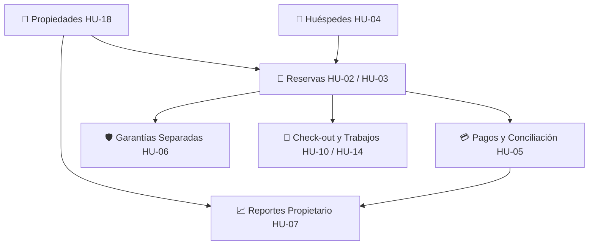

# 13 — Mapa de Rutas, Navegación y Componentes Frontend

**Proyecto:** Daplace Rentals — MVP Transaccional  
**Corte:** 28 de octubre de 2026  
**Responsables:** André (Módulos de Gestión Inmobiliaria, Huéspedes, Reservas, Pagos, Garantías y Sidebar) y Diego (Autenticación, Layout, Enrutador Principal, Dashboard y Reportes).

---

## 1. Mapa de Rutas Previsto y Asignación de Responsabilidades

| Ruta | Nombre del Módulo | Responsable | Estado Actual | HU / RF Relacionada | Descripción |
|---|---|---|---|---|---|
| `/login` | Acceso al Sistema | **Diego** | *En desarrollo por Diego* | RF09 / HU-08 | Pantalla de inicio de sesión y gestión de credenciales. **No forma parte del menú lateral.** |
| `/dashboard` | Dashboard Principal | **Diego** | *Pendiente* | RF09 / HU-08 | Resumen general, KPIs iniciales y accesos directos. |
| `/propiedades` | Gestión de Propiedades | **André** | **DISPONIBLE (Mock)** | RF01 / HU-18 | Catálogo, alta, edición, filtros, vinculación de propietario e inmunidad financiera (desactivación lógica). |
| `/huespedes` | Directorio de Huéspedes | **André** | **DISPONIBLE (Mock)** | RF04 / HU-04 | Registro, edición, búsqueda y visualización de reservas relacionadas. Validación de al menos un contacto. |
| `/reservas` | Gestión de Reservas | **André** | **DISPONIBLE (Mock)** | RF02, RF03 / HU-02, HU-03 | Solicitudes, confirmación, prevención de solapes con intervalos [ingreso, salida), liberación por cancelación y reprogramación. |
| `/calendario` | Calendario Operativo | **André** | **DISPONIBLE (Mock)** | RF01 / HU-01 | Vista mensual de disponibilidad, días ocupados, días de transición (check-out/check-in), detección de bloqueos y trazabilidad directa a reservas. |
| `/pagos` | Pagos y Conciliación | **André** | *Próximo (P0)* | RF05 / HU-05 | Registro de adelantos, saldos pendientes y conciliación explícita e idempotente. |
| `/garantias` | Control de Garantías | **André** | *Próximo (P0)* | RF06 / HU-06 | Custodia separada de fondos, devoluciones y retenciones limitadas al saldo disponible. |
| `/reportes` | Reportes de Liquidación | **Diego** | *Próximo (P0)* | RF08, RF12 / HU-07, HU-12 | Reportes por propiedad y período con desglose reproducible y autorización por propietario. |
| `/mantenimiento` | Mantenimiento y Salidas | **Compartido** | *Próximo (P1)* | RF07, RF13 / HU-10, HU-14 | Registro de check-out, necesidades de mantenimiento y asignación de trabajos. |
| `/personal` | Personal y Cuentas | **Diego** | *Próximo (P1)* | RF09 / HU-19 | Administración de cuentas internas y roles de operador/mantenimiento. |

---

## 2. Componentes Existentes y Rutas de Importación

### Módulo de Navegación y Sidebar
* **Ubicación:** `frontend/src/shared/navigation/`
* **Importación:**
  ```tsx
  import { Sidebar, NAVIGATION_ITEMS } from '../shared/navigation';
  import type { NavigationItem, SidebarProps } from '../shared/navigation';
  ```

### Módulo de Propiedades (UI-ANDRE-001)
* **Ubicación:** `frontend/src/features/properties/`
* **Importación:**
  ```tsx
  import { PropertiesPage } from '../features/properties';
  import type { Property, Propietario, CreatePropertyDto } from '../features/properties';
  ```
* **Componentes internos reutilizables:**
  * `PropertiesPage`: Vista completa con filtros, métricas, tabla y modales.
  * `PropertyList`: Tabla responsiva con badges y acciones.
  * `PropertyFiltersBar`: Barra de filtros por texto, estado operativo, estado publicación y activas.
  * `PropertyFormModal`: Modal para creación y edición con validación.
  * `PropertyDetailModal`: Ficha completa del inmueble y su propietario.

### Módulo de Huéspedes (UI-ANDRE-001)
* **Ubicación:** `frontend/src/features/guests/`
* **Importación:**
  ```tsx
  import { GuestsPage } from '../features/guests';
  import type { Guest, GuestWithReservations, CreateGuestDto } from '../features/guests';
  ```
* **Componentes internos reutilizables:**
  * `GuestsPage`: Vista completa con búsqueda, métricas de contacto y modales.
  * `GuestList`: Tabla de huéspedes con teléfono, email y documento.
  * `GuestFiltersBar`: Input de búsqueda en tiempo real.
  * `GuestFormModal`: Modal de registro y edición con validación estricta de contacto (teléfono o correo).
  * `GuestDetailModal`: Ficha del huésped con tabla de reservas vinculadas.

### Módulo de Reservas (UI-ANDRE-002)
* **Ubicación:** `frontend/src/features/reservations/`
* **Importación:**
  ```tsx
  import { ReservationsPage, reservationService } from '../features/reservations';
  import type { Reservation, CreateReservationDto, UpdateReservationDatesDto } from '../features/reservations';
  ```
* **Componentes internos reutilizables:**
  * `ReservationsPage`: Vista completa con KPIs de reservas, filtros combinados, tabla y modales.
  * `ReservationList`: Tabla de reservas con badges de estado (`SOLICITADA`, `CONFIRMADA`, `COMPLETADA`, `CANCELADA`) y acciones.
  * `ReservationFilters`: Filtros por texto libre, propiedad, huésped y estado de reserva.
  * `ReservationFormModal`: Registro de solicitud con cálculo automático de noches y validación de disponibilidad en tiempo real.
  * `ReservationDetailModal`: Ficha completa de la reserva con acciones de confirmación y cancelación con motivo.
  * `ReservationDateEditModal`: Modal de reprogramación de fechas con validación de solape excluyendo la propia reserva.

### Módulo de Disponibilidad y Calendario (UI-ANDRE-002)
* **Ubicación:** `frontend/src/features/calendar/`
* **Importación:**
  ```tsx
  import { CalendarPage, calendarService } from '../features/calendar';
  import type { CalendarDay, MonthOccupancySummary } from '../features/calendar';
  ```
* **Componentes internos reutilizables:**
  * `CalendarPage`: Vista mensual interactiva con selector de inmuebles, navegación temporal, KPIs de ocupación y detalle modal de reserva.
  * `CalendarGrid`: Cuadrícula mensual de 7 columnas (Lunes a Domingo) con cálculo de padding, pills de reserva clickeables y badges de transición (Check-out/Check-in).
  * `CalendarLegend`: Guía visual de estados (Disponible, Ocupado, Transición, Mantenimiento, Inactiva).

---

## 3. Contrato de Propiedades del Componente Sidebar

El componente `Sidebar` fue diseñado deliberadamente **desacoplado de React Router** para permitir que Diego lo integre en su layout definitivo utilizando el mecanismo de navegación que considere oportuno (`useNavigate`, `NavLink` o wrapper).

```typescript
export interface SidebarProps {
  /** Ruta activa actual (ej. '/propiedades', '/huespedes') */
  currentPath: string;
  /** Callback ejecutado al hacer clic en un elemento */
  onNavigate?: (path: string, item: NavigationItem) => void;
  /** Lista personalizada de elementos (por defecto usa NAVIGATION_ITEMS) */
  items?: NavigationItem[];
  /** Estado de colapso en pantallas grandes (modo compacto de solo iconos) */
  collapsed?: boolean;
  /** Callback para alternar el colapso */
  onToggleCollapse?: () => void;
  /** Clases CSS adicionales */
  className?: string;
}
```

### Paleta Corporativa Aplicada
* **Midnight (`#162A2C`):** Fondo del sidebar y cabeceras de navegación.
* **Forest Green (`#5E6C5B`):** Indicador de sección activa y resaltes primarios.
* **Cloud White (`#FEFCF6`):** Textos principales e iconos activos.
* **Fresh Cream (`#F4EFF6`):** Fondos de badges y contenedores auxiliares.
* **Sky Blue (`#D6E0E2`):** Textos secundarios y bordes sutiles.
* **Storm Cloud (`#686867`):** Textos atenuados y estados inactivos.

---

## 4. Instrucciones para que Diego Integre el Sidebar en `App.tsx`

Para conectar el `Sidebar` en el layout administrativo principal con `react-router`:

```tsx
import { useState } from 'react';
import { Routes, Route, useNavigate, useLocation } from 'react-router';
import { Sidebar } from './shared/navigation';
import { PropertiesPage } from './features/properties';
import { GuestsPage } from './features/guests';
import { ReservationsPage } from './features/reservations';
import { CalendarPage } from './features/calendar';

export default function AdminLayout() {
  const navigate = useNavigate();
  const location = useLocation();
  const [collapsed, setCollapsed] = useState(false);

  return (
    <div className="min-h-screen bg-[#f7f7f5] flex">
      {/* 1. Sidebar reutilizable */}
      <Sidebar
        currentPath={location.pathname}
        onNavigate={(path) => navigate(path)}
        collapsed={collapsed}
        onToggleCollapse={() => setCollapsed(!collapsed)}
      />

      {/* 2. Área principal de contenido */}
      <div className="flex-1 flex flex-col min-w-0">
        <main className="flex-1 p-6">
          <Routes>
            <Route path="/propiedades" element={<PropertiesPage />} />
            <Route path="/huespedes" element={<GuestsPage />} />
            <Route path="/reservas" element={<ReservationsPage />} />
            <Route path="/calendario" element={<CalendarPage />} />
            {/* Rutas de Diego y futuros módulos */}
            <Route path="/dashboard" element={<DashboardPlaceholder />} />
            {/* ... */}
          </Routes>
        </main>
      </div>
    </div>
  );
}
```

---

## 5. Dependencias Entre Pantallas y Flujos Futuros



* **Reservas** requerirá el selector de propiedades (`Property`) y de huéspedes (`Guest`).
* **Pagos y Garantías** requerirán la referencia de una reserva confirmada (`reservaId`).
* **Reportes** requerirá pagos conciliados y propiedad asociada.

---

## 6. Reglas de Gobernanza y No Duplicación

1. **No duplicar componentes:** Diego no debe reescribir ni duplicar `PropertiesPage`, `GuestsPage` ni `Sidebar`. Si se requieren ajustes visuales globales, deben aplicarse sobre las propiedades o temas compartidos.
2. **Inmunidad Financiera:** Las propiedades no admiten borrado físico. Se utiliza desactivación lógica (`activa: false`, `estadoOperativo: 'INACTIVA'`) para preservar el histórico de reservas y liquidaciones.
3. **Advertencia sobre la Vista Previa Temporal:** Los archivos `frontend/preview.html` y `frontend/src/preview.tsx` son exclusivamente herramientas de desarrollo para validar los flujos mock locales en `http://localhost:5173/preview.html`. Una vez que Diego integre las rutas y el layout en `App.tsx`, estos dos archivos temporales serán retirados.
