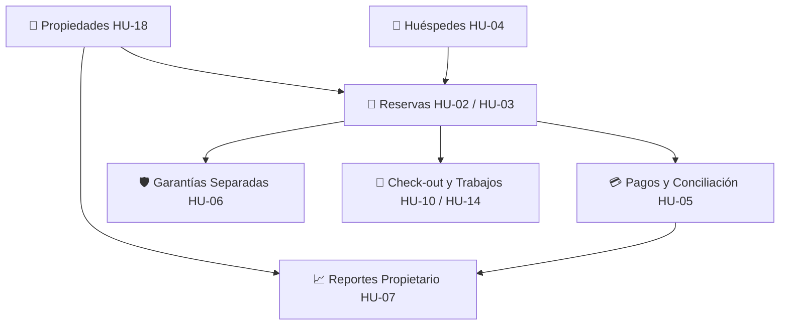

# 13 — Mapa de Rutas, Navegación y Componentes Frontend

**Proyecto:** Daplace Rentals — MVP Transaccional  
**Corte:** 28 de octubre de 2026  
**Responsables:** André (Módulos de Gestión Inmobiliaria, Huéspedes, Reservas, Pagos, Garantías y Sidebar) y Diego (Autenticación, Layout, Enrutador Principal, Dashboard y Reportes).

---

## 1. Mapa de Rutas Previsto y Asignación de Responsabilidades

| Ruta | Nombre del Módulo | Responsable | Estado Actual | HU / RF Relacionada | Descripción |
|---|---|---|---|---|---|
| `/login` | Acceso al Sistema | **Diego** | **COMPLETO_VERIFICADO** | RF09 / HU-08 | Pantalla de inicio de sesión real, cookies seguras, JWT en memoria y selector de cuentas demo. |
| `/propiedades` | Gestión de Propiedades | **André** | **COMPLETO_VERIFICADO** | RF01 / HU-18 | Catálogo, alta, edición, filtros, vinculación de propietario y filtrado estricto por `usuarioId`. |
| `/huespedes` | Directorio de Huéspedes | **André** | **COMPLETO_VERIFICADO** | RF04 / HU-04 | Registro, edición, búsqueda y visualización de reservas. Validación obligatoria de contacto. |
| `/reservas` | Gestión de Reservas | **André** | **COMPLETO_VERIFICADO** | RF02, RF03 / HU-02, HU-03 | Solicitudes, confirmación, prevención de solapes en PostgreSQL, cancelación con motivo y contratos. |
| `/calendario` | Calendario Operativo | **André** | **COMPLETO_VERIFICADO** | RF01 / HU-01 | Vista mensual de disponibilidad, días ocupados, días de transición (check-out/check-in) y sincronización API. |
| `/pagos` | Pagos y Conciliación | **André** | **COMPLETO_VERIFICADO** | RF05 / HU-05 | Registro de adelantos con idempotencia, conciliación explícita, rechazo, saldo exacto y vouchers. |
| `/garantias` | Control de Garantías | **André** | **COMPLETO_VERIFICADO** | RF06 / HU-06 | Custodia separada, libro inmutable de movimientos, devoluciones y retenciones limitadas al saldo. |
| `/gastos` | Gastos Operativos | **André** | **COMPLETO_VERIFICADO** | — / HU-21 | Egresos por propiedad y categoría contable, sustentos digitales, aprobación y anulación controlada. |
| `/catalogo` | Catálogo Público de Propiedades | **André** | **FEATURE_FLAG** | RF01 / HU-01 | Vista pública con filtro en tiempo real. Activa solo con `VITE_ENABLE_PUBLIC_BOOKING=true`. |
| `/solicitar-reserva` | Solicitud Pública de Reserva | **André** | **FEATURE_FLAG** | RF01, RF02 / HU-01, HU-02 | Formulario público de reserva. Activa solo con `VITE_ENABLE_PUBLIC_BOOKING=true`. |
| `/dashboard` | Dashboard Principal | **Diego** | *PENDIENTE (Placeholder)* | RF09 / HU-08 | Resumen general y KPIs operativos (muestra `PendingModuleView`). |
| `/reportes` | Reportes de Liquidación | **Diego / André** | *PENDIENTE (P0 Demo)* | RF08, RF12 / HU-07, HU-12 | Liquidaciones por propiedad y período con desglose reproducible (muestra `PendingModuleView`). |
| `/personal` | Personal y Cuentas | **Diego** | *PARCIAL (P1)* | RF09 / HU-19 | Cuentas gestionadas vía script `seed-dev.ts` (pantalla muestra `PendingModuleView`). |
| `/mantenimiento` | Mantenimiento y Salidas | **Compartido** | *PENDIENTE (P1)* | RF07, RF13 / HU-10, HU-14 | Registro de check-out y trabajos de campo (muestra `PendingModuleView`). |

---

## 2. Componentes Existentes y Rutas de Importación

### Módulo de Navegación y Sidebar
* **Ubicación:** `frontend/src/shared/navigation/`
* **Importación:**
  ```tsx
  import { Sidebar, NAVIGATION_ITEMS } from '../shared/navigation';
  import type { NavigationItem, SidebarProps } from '../shared/navigation';
  ```

### Módulo de Propiedades (UI-ANDRE-001)
* **Ubicación:** `frontend/src/features/properties/`
* **Importación:**
  ```tsx
  import { PropertiesPage } from '../features/properties';
  import type { Property, Propietario, CreatePropertyDto } from '../features/properties';
  ```
* **Componentes internos reutilizables:**
  * `PropertiesPage`: Vista completa con filtros, métricas, tabla y modales.
  * `PropertyList`: Tabla responsiva con badges y acciones.
  * `PropertyFiltersBar`: Barra de filtros por texto, estado operativo, estado publicación y activas.
  * `PropertyFormModal`: Modal para creación y edición con validación.
  * `PropertyDetailModal`: Ficha completa del inmueble y su propietario.

### Módulo de Huéspedes (UI-ANDRE-001)
* **Ubicación:** `frontend/src/features/guests/`
* **Importación:**
  ```tsx
  import { GuestsPage } from '../features/guests';
  import type { Guest, GuestWithReservations, CreateGuestDto } from '../features/guests';
  ```
* **Componentes internos reutilizables:**
  * `GuestsPage`: Vista completa con búsqueda, métricas de contacto y modales.
  * `GuestList`: Tabla de huéspedes con teléfono, email y documento.
  * `GuestFiltersBar`: Input de búsqueda en tiempo real.
  * `GuestFormModal`: Modal de registro y edición con validación estricta de contacto (teléfono o correo).
  * `GuestDetailModal`: Ficha del huésped con tabla de reservas vinculadas.

### Módulo de Reservas (UI-ANDRE-002)
* **Ubicación:** `frontend/src/features/reservations/`
* **Importación:**
  ```tsx
  import { ReservationsPage, reservationService } from '../features/reservations';
  import type { Reservation, CreateReservationDto, UpdateReservationDatesDto } from '../features/reservations';
  ```
* **Componentes internos reutilizables:**
  * `ReservationsPage`: Vista completa con KPIs de reservas, filtros combinados, tabla y modales.
  * `ReservationList`: Tabla de reservas con badges de estado (`SOLICITADA`, `CONFIRMADA`, `COMPLETADA`, `CANCELADA`) y acciones.
  * `ReservationFilters`: Filtros por texto libre, propiedad, huésped y estado de reserva.
  * `ReservationFormModal`: Registro de solicitud con cálculo automático de noches y validación de disponibilidad en tiempo real.
  * `ReservationDetailModal`: Ficha completa de la reserva con acciones de confirmación y cancelación con motivo.
  * `ReservationDateEditModal`: Modal de reprogramación de fechas con validación de solape excluyendo la propia reserva.

### Módulo de Disponibilidad y Calendario (UI-ANDRE-002)
* **Ubicación:** `frontend/src/features/calendar/`
* **Importación:**
  ```tsx
  import { CalendarPage, calendarService } from '../features/calendar';
  import type { CalendarDay, MonthOccupancySummary } from '../features/calendar';
  ```
* **Componentes internos reutilizables:**
  * `CalendarPage`: Vista mensual interactiva con selector de inmuebles, navegación temporal, KPIs de ocupación y detalle modal de reserva.
  * `CalendarGrid`: Cuadrícula mensual de 7 columnas (Lunes a Domingo) con cálculo de padding, pills de reserva clickeables y badges de transición (Check-out/Check-in).
  * `CalendarLegend`: Guía visual de estados (Disponible, Ocupado, Transición, Mantenimiento, Inactiva).

### Módulo de Pagos y Conciliación (UI-ANDRE-003)
* **Ubicación:** `frontend/src/features/payments/`
* **Importación:**
  ```tsx
  import { PaymentsPage, paymentService, financialReadService } from '../features/payments';
  import type { Payment, CreatePaymentDto, ReconcilePaymentDto, RejectPaymentDto, ReservationFinancialSummary } from '../features/payments';
  ```
* **Componentes internos reutilizables:**
  * `PaymentsPage`: Vista completa con KPIs de cobranza (Total Conciliado, Pendientes, Rechazados, Sobrepagos detectados), banner de inmunidad financiera, filtros combinados, tabla y modales.
  * `PaymentList`: Tabla de pagos con badges de estado (`PENDIENTE_CONCILIACION`, `CONCILIADO`, `RECHAZADO`), método, referencia, notas de rechazo y acciones contextuales.
  * `PaymentFilters`: Filtro por texto libre, selector de propiedad, selector de reserva vinculada y estado de conciliación.
  * `PaymentFormModal`: Registro de adelantos y abonos con validación de importes positivos y clave de idempotencia generada automáticamente.
  * `PaymentReconcileModal`: Modal de conciliación bancaria explícita con fecha valor y nota de auditoría.
  * `PaymentRejectModal`: Modal de rechazo formal con motivo obligatorio.
  * `PaymentDetailModal`: Ficha de auditoría del pago con trazabilidad de fechas, reserva asociada y resumen de cobranza.

### Módulo de Garantías en Custodia (UI-ANDRE-003)
* **Ubicación:** `frontend/src/features/guarantees/`
* **Importación:**
  ```tsx
  import { GuaranteesPage, guaranteeService } from '../features/guarantees';
  import type { Guarantee, MovimientoGarantia, CreateGuaranteeDto, RegisterGuaranteeMovementDto } from '../features/guarantees';
  ```
* **Componentes internos reutilizables:**
  * `GuaranteesPage`: Vista completa con KPIs de custodia (Total en Custodia Activa, Retenciones por Daños, Devoluciones, Garantías Liquidadas), banner de custodia separada, filtros y modales.
  * `GuaranteeList`: Tabla de depósitos en garantía con badges de estado (`PENDIENTE`, `CUSTODIADA`, `DEVUELTA_PARCIAL`, `LIQUIDADA_TOTAL`), desglose de saldo disponible y acciones.
  * `GuaranteeFilters`: Filtro por texto de reserva, selector de propiedad y estado de garantía.
  * `GuaranteeFormModal`: Registro de recepción de depósito en garantía (política mock: máximo 1 garantía por reserva) que inicializa el movimiento en el libro mayor.
  * `GuaranteeMovementModal`: Registro de movimientos contables (Devolución Parcial, Devolución Total o Retención por Daños) validando estrictamente no exceder el saldo disponible.
  * `GuaranteeDetailModal`: Ficha del depósito con libro mayor cronológico e inmutable de todos los movimientos registrados.

### Módulo de Utilidades Financieras Compartidas (UI-ANDRE-003)
* **Ubicación:** `frontend/src/shared/money/`
* **Importación:**
  ```tsx
  import {
    toCents,
    fromCents,
    addMoney,
    subtractMoney,
    compareMoney,
    formatMoney,
    validateMoneyInput,
    adaptReservationAmount,
  } from '../shared/money';
  ```
* **Características:**
  * Aritmética exacta en unidades enteras menores (céntimos). Evita errores de redondeo de punto flotante binario IEEE 754.
  * Adaptador explícito y provisional `adaptReservationAmount` para interoperar con `Reservation.montoAcordado` sin alterar contratos legados de reservas.
  * Validación estricta de importes (mayor que cero, máximo 2 decimales, no negativos ni NaN).

### Módulo Público de Catálogo y Solicitud de Reserva (UI-ANDRE-004)
* **Ubicación:** `frontend/src/features/public-booking/`
* **Importación:**
  ```tsx
  import {
    PublicLayout,
    PublicCatalogPage,
    PublicBookingRequestPage,
    publicBookingService,
  } from '../features/public-booking';
  import type {
    PublicProperty,
    PublicBookingRequestDto,
    PublicAvailabilityCheck,
    PublicBookingResult,
  } from '../features/public-booking';
  ```
* **Componentes y Vistas:**
  * `PublicLayout`: Shell público independiente de `AdminLayout`, con navbar pública, enlaces al catálogo, solicitud y acceso al panel de operadores.
  * `PublicCatalogPage`: Vista `/catalogo` con hero informativo, buscador en tiempo real por nombre y distrito, selector de huéspedes y tarjetas de inmuebles.
  * `PropertyCard`: Ficha pública con nombre, dirección resumida, capacidad de huéspedes, precio referencial base y botón de llamada a la acción "Consultar Disponibilidad".
  * `PublicBookingRequestPage`: Formulario `/solicitar-reserva` con preselección por query param (`?propiedadId=...`), selector de fechas con consulta en tiempo real de disponibilidad por intervalo semiabierto `[ingreso, salida)`, campos obligatorios de contacto y pantalla de confirmación con identificador de solicitud y estado `SOLICITADA`.
  * `publicBookingService`: Capa de orquestación que consulta `propertyService`, `guestService` y `reservationService`. Filtra estrictamente propiedades activas, operativas y publicadas, protegiendo datos internos de propietarios y finanzas privadas.

---

## 3. Contrato de Propiedades del Componente Sidebar

El componente `Sidebar` fue diseñado deliberadamente **desacoplado de React Router** para permitir que Diego lo integre en su layout definitivo utilizando el mecanismo de navegación que considere oportuno (`useNavigate`, `NavLink` o wrapper).

```typescript
export interface SidebarProps {
  /** Ruta activa actual (ej. '/propiedades', '/huespedes') */
  currentPath: string;
  /** Callback ejecutado al hacer clic en un elemento */
  onNavigate?: (path: string, item: NavigationItem) => void;
  /** Lista personalizada de elementos (por defecto usa NAVIGATION_ITEMS) */
  items?: NavigationItem[];
  /** Estado de colapso en pantallas grandes (modo compacto de solo iconos) */
  collapsed?: boolean;
  /** Callback para alternar el colapso */
  onToggleCollapse?: () => void;
  /** Clases CSS adicionales */
  className?: string;
}
```

### Paleta Corporativa Aplicada
* **Midnight (`#162A2C`):** Fondo del sidebar y cabeceras de navegación.
* **Forest Green (`#5E6C5B`):** Indicador de sección activa y resaltes primarios.
* **Cloud White (`#FEFCF6`):** Textos principales e iconos activos.
* **Fresh Cream (`#F4EFF6`):** Fondos de badges y contenedores auxiliares.
* **Sky Blue (`#D6E0E2`):** Textos secundarios y bordes sutiles.
* **Storm Cloud (`#686867`):** Textos atenuados y estados inactivos.

---

## 4. Instrucciones para que Diego Integre el Sidebar en `App.tsx`

Para conectar el `Sidebar` en el layout administrativo principal con `react-router`:

```tsx
import { useState } from 'react';
import { Routes, Route, useNavigate, useLocation } from 'react-router';
import { Sidebar } from './shared/navigation';
import { PropertiesPage } from './features/properties';
import { GuestsPage } from './features/guests';
import { ReservationsPage } from './features/reservations';
import { CalendarPage } from './features/calendar';
import { PaymentsPage } from './features/payments';
import { GuaranteesPage } from './features/guarantees';

export default function AdminLayout() {
  const navigate = useNavigate();
  const location = useLocation();
  const [collapsed, setCollapsed] = useState(false);

  return (
    <div className="min-h-screen bg-[#f7f7f5] flex">
      {/* 1. Sidebar reutilizable */}
      <Sidebar
        currentPath={location.pathname}
        onNavigate={(path) => navigate(path)}
        collapsed={collapsed}
        onToggleCollapse={() => setCollapsed(!collapsed)}
      />

      {/* 2. Área principal de contenido */}
      <div className="flex-1 flex flex-col min-w-0">
        <main className="flex-1 p-6">
          <Routes>
            <Route path="/propiedades" element={<PropertiesPage />} />
            <Route path="/huespedes" element={<GuestsPage />} />
            <Route path="/reservas" element={<ReservationsPage />} />
            <Route path="/calendario" element={<CalendarPage />} />
            <Route path="/pagos" element={<PaymentsPage />} />
            <Route path="/garantias" element={<GuaranteesPage />} />
            {/* Rutas de Diego y futuros módulos */}
            <Route path="/dashboard" element={<DashboardPlaceholder />} />
            {/* ... */}
          </Routes>
        </main>
      </div>
    </div>
  );
}
```

### Servicio Financiero de Lectura Compartido para Diego (`financialReadService`)
Para construir el **Dashboard** y los **Reportes de Liquidación** sin duplicar cálculos contables ni vulnerar las reglas de separación patrimonial, Diego puede consumir directamente:

```typescript
import { financialReadService } from './features/payments';

// 1. Resumen financiero consolidado por reserva:
const summary = await financialReadService.getReservationSummary('res-01');
// -> montoAcordado, totalConciliado, totalPendiente, saldoPendiente, hasOverpayment, sobrepagoMonto, estadoLiquidacion

// 2. Desglose contable por propiedad y moneda (solo pagos CONCILIADO):
const propertyIncome = await financialReadService.getConciliatedIncomeByProperty('prop-01', 'USD');
// -> totalConciliado, totalPagosConciliados, reservasAfectadas

// 3. Custodia de garantías separada de ingresos por propiedad:
const propertyGuarantees = await financialReadService.getGuaranteesSummaryByProperty('prop-01', 'USD');
// -> totalEnCustodia, totalDevuelto, totalRetenido, garantiasActivas

// 4. Métricas globales para tarjetas del Dashboard:
const globalKpis = await financialReadService.getGlobalFinancialKpis('USD');

// 5. Libro mayor unificado con separación estricta de rubro (ALQUILER vs GARANTIA_CUSTODIA):
const ledger = await financialReadService.getFinancialLedger({ rubro: 'ALQUILER', fechaInicio: '2026-10-01' });
```

> **Aviso de Gobernanza Financiera:**  
> - Los filtros temporales y el criterio de devengo vs. caja en `financialReadService` tienen carácter **provisional** hasta que el negocio apruebe formalmente la política definitiva de liquidaciones a propietarios (RF08).
> - Las garantías **NUNCA** deben sumarse a la línea de ingresos de alquiler de los propietarios.


---

## 5. Dependencias Entre Pantallas y Flujos Futuros



* **Reservas** utiliza el selector de propiedades (`Property`) y de huéspedes (`Guest`).
* **Pagos y Garantías** asocian una reserva existente (`reservaId`), validan consistencia de moneda y mantienen estados y movimientos inmutables.
* **Dashboard y Reportes (Diego)** consumirán los métodos de `financialReadService`, garantizando que únicamente los pagos `CONCILIADO` se reconozcan como ingresos y que los depósitos de garantía permanezcan en custodia contable separada.

---

## 6. Reglas de Gobernanza y No Duplicación

1. **No duplicar componentes:** Diego no debe reescribir ni duplicar `PropertiesPage`, `GuestsPage` ni `Sidebar`. Si se requieren ajustes visuales globales, deben aplicarse sobre las propiedades o temas compartidos.
2. **Inmunidad Financiera:** Las propiedades no admiten borrado físico. Se utiliza desactivación lógica (`activa: false`, `estadoOperativo: 'INACTIVA'`) para preservar el histórico de reservas y liquidaciones.
3. **Enrutamiento Real y Retiro de Archivos Temporales (UI-INTEGRATION-001):** La aplicación ha sido completamente unificada bajo React Router en `src/app/App.tsx` y `src/app/AdminLayout.tsx`. El punto de entrada oficial es `index.html` y la aplicación carga en `http://127.0.0.1:5173/`. Los archivos temporales `preview.html` y `preview.tsx` han sido formalmente retirados. Todas las páginas disponen de URLs propias y el Sidebar navega directamente en el enrutador cliente sin recargar la página ni reiniciar los servicios mock en memoria.
